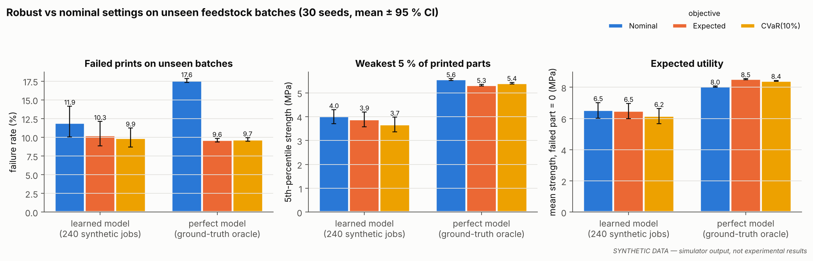
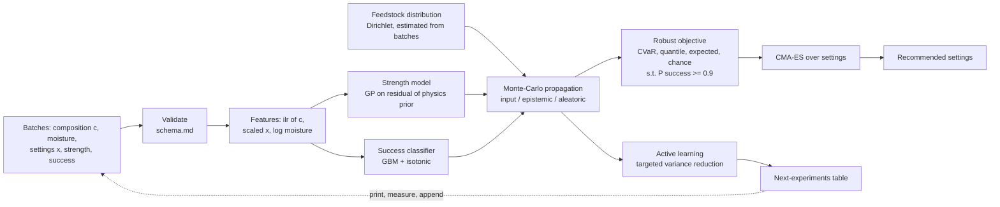

# RobustPrint

**Choosing 3D-printing settings for recycled plastic whose composition changes from batch to batch, and saying how sure we can be about the strength of the parts.**



*All results in this README come from a **simulator** (synthetic data) unless explicitly marked otherwise. They show how the method behaves on a plausible but invented material system. They are not experimental findings. See [LIMITATIONS](docs/LIMITATIONS.md).*

---

## 1. The problem

On the International Space Station, most trash is packaging: plastic films, foams, food
wrappers, cloth and fibres. NASA has flown a combined plastic recycler and 3D printer
(the Refabricator, built by Tethers Unlimited [NASA-REFAB]), so recycling waste into new
parts in space is no longer hypothetical. The difficulty is the feedstock. A recycled
batch is a **mixture**: some polyethylene, some PET, some nylon, a few fibres, some foam
or food residue. Its exact composition is only roughly known and changes from one batch
to the next.

Most guidance for fused-filament (FDM) printing assumes clean, consistent filament. With
mixed waste, settings tuned for the *average* batch can fail on the next one: a fibre-rich
batch clogs at high speed, a PET-rich batch needs a hotter nozzle, a contaminated batch
degrades when the nozzle is too hot. RobustPrint asks:

> Given a feedstock whose composition is known only as a probability distribution, which
> print settings should we use, and how confident can we be in the resulting part strength?

It does four things:

1. **Represents composition as a distribution** (a Dirichlet over mass fractions), not a point.
2. **Predicts strength with calibrated uncertainty**, split into feedstock (input), model
   (epistemic) and noise (aleatoric) parts, plus the probability that a print succeeds.
3. **Recommends robust settings** that maximise a low quantile or CVaR of strength, or the
   expected strength, over the composition distribution, under a print-success constraint.
4. **Recommends the next experiments** (active learning) and writes them as a table a
   researcher can take to the printer.

The code is written so the author can replace the simulator with real measurements
through a documented CSV schema ([`data/schema.md`](data/schema.md)).

## 2. Key results (synthetic)

Each number below is computed by `robustprint reproduce --full` and stored in the linked
file (see `results/full/manifest.json` for versions, seeds and timings). Protocol and
hypotheses were **pre-registered** in [METHODS §8](docs/METHODS.md#8-evaluation-protocol-pre-registered)
before the final runs.

**Setup (E1).** 30 seeds. In each seed a simulated lab prints a training campaign of
240 jobs (60 feedstock batches × 4 settings × 3 specimens; about 102 jobs print
successfully). A physics-residual Gaussian process and a calibrated success classifier
are trained on it. Each objective recommends one setting, which is printed once on each of
2 000 **fresh, unseen batches**. Ground-truth outcomes come from the simulator.

| Objective (learned model) | Failure rate | 5th-pct strength of good parts (MPa) | Expected utility (MPa) |
|---|---|---|---|
| Nominal (mean composition) | 11.9 % [10.0, 14.2] | 4.02 [3.71, 4.30] | 6.53 [6.03, 7.01] |
| Expected over composition | 10.3 % [8.8, 12.1] | 3.89 [3.57, 4.19] | 6.50 [5.99, 6.97] |
| 5 % quantile | 9.9 % [8.9, 11.2] | 3.70 [3.37, 4.02] | 6.19 [5.65, 6.69] |
| CVaR (10 %) | 9.9 % [8.7, 11.2] | 3.67 [3.36, 3.98] | 6.15 [5.65, 6.65] |
| Chance-constrained | 10.3 % [9.1, 11.8] | 4.00 [3.74, 4.24] | 6.66 [6.24, 7.04] |
| *Oracle nominal (true function)* | *17.6 %* | *5.56* | *8.05* |
| *Oracle expected (true function)* | *9.6 %* | *5.32* | *8.52* |

Mean over seeds [95 % bootstrap CI]. Expected utility counts a failed print as 0 MPa.
Files: [`e1_optimisation/summary.csv`](results/full/e1_optimisation/summary.csv),
[`tests.csv`](results/full/e1_optimisation/tests.csv),
[`per_seed.csv`](results/full/e1_optimisation/per_seed.csv).

What this shows:

- **With a learned model, the robust objectives did not beat the nominal one in any way we
  could confirm.** They lowered the failure rate by 1.6–2.0 percentage points, but no
  difference survived Holm correction (smallest adjusted p = 1.0; smallest unadjusted
  p = 0.055). Pre-registered H1 (lower failure rate) and H3 (different expected utility)
  are therefore not supported. H2 (quantile/CVaR raise the weakest parts' strength) went
  the *wrong way*: CVaR lowered the 5th-percentile strength by 0.34 MPa (95 % CI
  [−0.61, −0.10]; Holm p = 1.0).
- **With a perfect model, accounting for composition uncertainty matters.** The oracle
  versions nearly halve the failure rate (17.6 % → 9.6 %) and raise expected utility by
  0.47 MPa (6 %) relative to the oracle nominal setting
  ([`tests_oracle_exploratory.csv`](results/full/e1_optimisation/tests_oracle_exploratory.csv);
  exploratory, not pre-registered). In this simulator the gain comes from **avoiding failed
  prints** (fibre-rich batches clog at high flow), not from stronger weak parts.
- **Model error, not the robust formulation, is the bottleneck.** Every learned-model
  recommendation loses about 2 MPa of expected utility against the oracle (regret 1.87–2.37 MPa).
  The fitted model assigns most of its predictive variance to "noise" (0.36 log-variance at
  the recommended settings vs 0.015 in the truth) because it cannot resolve the response
  from ~100 successful prints. Only 19–22 % of its variance is attributed to the feedstock,
  against 84 % in the ground truth
  ([`e4_propagation/decomposition.csv`](results/full/e4_propagation/decomposition.csv)).
  An optimiser cannot be robust to an uncertainty its model does not see.
- **Ablations** ([`e1b_ablations/`](results/full/e1b_ablations/), 15 seeds each). Only one
  variant produced Holm-significant differences: with twice the batch-to-batch spread, the
  *expected* objective cut failures from 16.7 % to 13.1 % (Holm p = 0.041), and CVaR lowered
  the mean strength of good parts by 1.44 MPa (Holm p = 0.032). Removing composition
  propagation, removing the physics prior, or telling the optimiser the wrong spread (×4 or ÷4)
  changed nothing beyond noise. A deep ensemble, although best-calibrated in
  cross-validation, made much worse recommendations (expected utility about 4.3 MPa
  instead of about 6.5 MPa): the optimiser exploits its errors. Quadrupling the data (120 batches) helped every
  objective (nominal 7.43 MPa); nominal stayed best.

**Models (E2,** [`e2_models/`](results/full/e2_models/)**).** Grouped cross-validation by
batch, 3 seeds, at 120 training batches (about 207 successful jobs):

| Model | RMSE (MPa) | NLL (log) | CRPS (log) | 90 % coverage |
|---|---|---|---|---|
| Physics rule of mixtures | 1.94 | 0.88 | 0.326 | 0.90 |
| Ridge + interactions | 1.58 | 0.61 | 0.246 | 0.90 |
| Gradient boosting (quantile) | 1.45 | 1.83 | 0.261 | 0.67 |
| GP (ARD Matérn) | 1.34 | 0.56 | 0.227 | 0.85 |
| Heteroscedastic GP | 1.30 | 0.79 | 0.227 | 0.76 |
| **Hybrid physics + GP** | 1.33 | **0.53** | **0.225** | 0.86 |
| Deep ensemble (5) | 1.52 | 0.65 | 0.259 | **0.92** |
| MC dropout | 1.58 | 0.78 | 0.265 | 0.85 |

- The physics prior helps most with **little data**: at 15 batches the hybrid GP's CRPS is
  0.377 vs 0.488 for the plain GP; at 120 batches they are equal (0.225 vs 0.227)
  ([`learning_curves.png`](results/full/figures/learning_curves.png)).
- The GP family under-covers. Split conformal wrapping fixes this in distribution: the
  hybrid GP with conformal intervals covers 93 % of new-batch outcomes at a nominal 90 %.
  Under feedstock shift it drops to 85 %
  ([`conformal.csv`](results/full/e2_models/conformal.csv)). With only 15 training
  batches, conformal intervals are infinite: the calibration set is too small for a 90 %
  guarantee.
- Print-success classifier: gradient boosting with isotonic calibration has Brier score
  0.146 vs 0.163 for regularised logistic regression (base rate 0.43)
  ([`classifier.csv`](results/full/e2_models/classifier.csv),
  [`reliability.png`](results/full/figures/reliability.png)).

**Other results.**

- *Active learning (E3,* [`per_round.csv`](results/full/e3_active_learning/per_round.csv)*)*:
  with 20 initial jobs and 8 rounds of 4, no strategy (targeted variance reduction,
  cost-aware, max-variance, Sobol) was distinguishable from random selection. Regret did not
  fall steadily with more jobs for any strategy ([`active_learning.png`](results/full/figures/active_learning.png)).
- *Propagation (E4)*: Monte Carlo with 256 draws estimates the predictive standard
  deviation within about 1 % (learned models) to 4 % (ground truth). The unscented
  transform (11 evaluations) is accurate for the smooth learned models (2.5 % error,
  hybrid GP) but not for the ground truth (26 %, worse than 16 random draws)
  ([`errors.csv`](results/full/e4_propagation/errors.csv)).
- *Sensitivity (E5,* [`global.csv`](results/full/e5_sensitivity/global.csv)*)*: over the
  search space, nozzle temperature dominates both strength (total Sobol index 0.58) and
  print success (0.74), followed by composition (0.25 and 0.29). At the recommended
  setting, contaminant content explains most composition-driven strength variation
  (first-order 0.49) and fibre content most of the success variation (0.47)
  ([`components.csv`](results/full/e5_sensitivity/components.csv)).
- *Pareto (E6,* [`front.csv`](results/full/e6_pareto/front.csv)*)*: raising the allowed
  print time from 0.75× to 1.4× the reference print raises the realised CVaR(10 %) strength
  of the CVaR-optimal setting from 2.6 to 4.6 MPa; beyond that, extra print time buys
  nothing ([`pareto.png`](results/full/figures/pareto.png)).
- *Public data (E7, real measurements, not synthetic)*: on the 50-row Kaggle PLA/ABS
  dataset (10 × repeated 5-fold CV), all four models tested had similar CRPS on log strength
  (0.206–0.212). Quantile gradient boosting was badly overconfident (NLL 25.6), and the deep
  ensemble's 90 % intervals had coverage closest to nominal (0.90)
  ([`e7_public_benchmark.csv`](results/full/e7_public_benchmark.csv)). The simulator's effect directions match the data for layer height,
  infill and fan, and disagree for nozzle temperature, bed temperature and speed
  ([`e7_public_trends.csv`](results/full/e7_public_trends.csv)). This dataset contains no
  recycled material.

## 3. Quickstart

```bash
git clone <this repo> && cd RobustPrint
make setup          # creates .venv, installs CPU-only PyTorch and the package
make fast           # end-to-end smoke run in about 2 minutes -> results/fast/
```

`make test` runs the test suite. `make full` reproduces every number in this README
(16 min 10 s on the 4-core CPU container used here; per-stage timings are in
`results/full/manifest.json`). `make public-data` first downloads the optional Kaggle
dataset for E7. `make app` starts the dashboard.

## 4. Using your own data

1. Record experiments in the CSV schema ([`data/schema.md`](data/schema.md); example in
   [`data/examples/`](data/examples/)). `robustprint starter-design` writes a 20-job
   space-filling design to start with.
2. `robustprint validate my.csv`: every problem is reported with row, value and allowed range.
3. `robustprint train my.csv --out models/mine.pkl`
4. `robustprint optimize models/mine.pkl --from-data my.csv --objective cvar`
5. `robustprint recommend-experiments models/mine.pkl --from-data my.csv --n 4`
   writes `next_experiments.csv/.md` to take to the printer.

The step-by-step lab guide, including how to measure composition and how to read the
outputs, is [docs/REAL_DATA_GUIDE.md](docs/REAL_DATA_GUIDE.md).

## 5. Method overview



- **Compositions** enter models through the isometric log-ratio transform (Egozcue et al.
  2003), because fractions live on a simplex.
- **Models:** an ARD Gaussian process (Rasmussen & Williams 2006) fitted to the residual
  of a simple physics prior (rule of mixtures × infill × raster-angle factor). Baselines and
  alternatives are a heteroscedastic GP (Kersting et al. 2007), deep ensembles
  (Lakshminarayanan et al. 2017), MC dropout (Gal & Ghahramani 2016), quantile gradient
  boosting and ridge regression. Split-conformal and CQR wrappers (Lei et al. 2018;
  Romano et al. 2019) give distribution-free intervals.
- **Robust optimisation:** sample-average approximation with common random numbers over
  composition draws, CVaR (Rockafellar & Uryasev 2000) and quantile objectives in the spirit
  of Bayesian optimisation of risk measures (Cakmak et al. 2020), optimised with CMA-ES
  (Hansen 2016) inside a safe nozzle-temperature window.
- **Simulator:** blend immiscibility penalty, Halpin–Tsai fibre stiffening (Halpin & Kardos
  1976), inclusion weakening, interlayer healing with the t^(1/4) law (Wool & O'Connor 1981;
  Sun et al. 2008), Tsai–Hill raster dependence (trend from Ahn et al. 2002), hot-end
  melt-rate limit, porosity, degradation, hydrolysis, clogging and warping, batch effects
  and heteroscedastic noise. Every coefficient is listed in
  [DECISIONS.md](docs/DECISIONS.md) as cited or as an assumption.

Full equations and the protocol: [docs/METHODS.md](docs/METHODS.md).

## 6. Limitations and what did not work

**Limitations** (full list: [docs/LIMITATIONS.md](docs/LIMITATIONS.md)): the simulator
uses simplified physics with assumed coefficients and has never been compared with real
recycled feedstock. A composition × process interaction was added to it deliberately,
before any experiments, because without one robust optimisation cannot matter
(ADR-012). Real data must show whether such interactions exist. The models are **not
validated for flight or safety-critical use**.

**What did not work**

1. **Robust objectives with a learned model.** No pre-registered benefit over nominal was
   confirmed (see §2). Quantile and CVaR objectives were slightly *worse* in lower-tail
   strength, because they are pessimistic about an inflated, mostly lack-of-fit "noise" term.
2. **Active learning.** Model-based experiment selection did not beat random or Sobol
   designs within 52 jobs. With so few successful prints the GP is too weak to target anything.
3. **The unscented transform** on the ground truth (26 % error in the predictive spread).
4. **Heteroscedastic GP:** no better than the homoscedastic GP (NLL 0.79 vs 0.56).
5. **Deep ensembles for optimisation:** good calibration in cross-validation did not
   translate into good recommendations.
6. **First attempts** (fixed before the final runs and documented in DECISIONS/PROGRESS):
   NLL-trained neural nets were badly overconfident until early stopping (ADR-015). The GP
   learned near-zero noise until a 3 % noise floor (ADR-014). A poly-2 logistic success
   model was worse than predicting the base rate at default regularisation. In the first
   simulator version, nominal and robust optima were identical (ADR-012).
7. **Out-of-distribution feedstock:** when batches came from a shifted stream (more fibre
   and contaminant), every method failed on 45–48 % of prints (oracle: 33 %), and conformal
   coverage fell below nominal.

## 7. Repository map

```
src/robustprint/
  physics/      composition transforms, materials table, mixing and process models, simulator
  data/         schema, validation, synthetic generator, loaders, public-data loader
  models/       baselines, GPs, neural models, conformal wrappers, success classifier
  uncertainty/  metrics, propagation (MC, unscented), Sobol sensitivity
  optimize/     robust objectives, CMA-ES optimiser, safe bounds
  active/       acquisition functions and next-experiment planner
  eval/         experiments E1-E7, deployment, statistics, reproduce runner
  viz/          figures
  cli.py        robustprint command-line interface
app/            Streamlit dashboard
configs/        fast.yaml and full.yaml experiment configurations
data/           schema.md, examples, (git-ignored) synthetic and external data
docs/           METHODS, LIMITATIONS, DECISIONS, REFERENCES, MODEL_CARD, REAL_DATA_GUIDE
results/full/   all raw result files and figures quoted above
tests/          unit, property-based and integration tests
```

## 8. References

All references were verified and are listed with links in
[docs/REFERENCES.md](docs/REFERENCES.md). Key ones: Egozcue et al. 2003 (ilr);
Rasmussen & Williams 2006 (GPs); Lakshminarayanan et al. 2017 (deep ensembles);
Romano et al. 2019 (CQR); Rockafellar & Uryasev 2000 (CVaR); Cakmak et al. 2020 (risk
measures in BO); Hansen 2016 (CMA-ES); Saltelli et al. 2010 (Sobol estimators); Sun et
al. 2008 and Wool & O'Connor 1981 (bond formation); Halpin & Kardos 1976; NASA
Refabricator and 3D Printing in Zero-G reports.

## 9. Citation

```bibtex
@software{robustprint2026,
  title   = {RobustPrint: uncertainty-aware print optimisation for recycled, variable-composition feedstock},
  year    = {2026},
  version = {1.0.0},
  note    = {Results are from synthetic data generated by the included simulator}
}
```

## 10. Licence

Code: [MIT](LICENSE). The optional Kaggle dataset has an unknown licence and is not
redistributed; it is downloaded on demand by `make public-data`.
