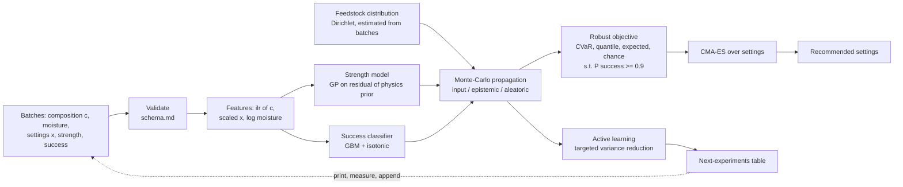

# RobustPrint

**Choosing 3D-printing settings for recycled plastic whose composition changes from batch to batch, and saying how sure we can be about the strength of the parts.**


*All results in this README come from a **simulator** (synthetic data) unless explicitly marked otherwise. They show how the method behaves on a plausible but invented material system. They are not experimental findings. See [LIMITATIONS](docs/LIMITATIONS.md).*

---

## 1. The problem

On the International Space Station, much of the logistics waste is packaging: plastic
films, foams and food wrappers, plus cloth and fibres
([NASA NTRS 20210023437](https://ntrs.nasa.gov/api/citations/20210023437/downloads/BlanchardAlexanderJ.pdf)).
NASA has tested a combined plastic recycler and 3D printer on the station (the
Refabricator, built by Tethers Unlimited;
[NASA Tech Briefs](https://www.techbriefs.com/component/content/article/37861-nasa-s-refabricator-recycles-waste-plastic-into-new-parts)),
so recycling waste into new parts in space is no longer hypothetical. The difficulty is the feedstock. A recycled
batch is a **mixture**: some polyethylene, some PET, some nylon, a few fibres, some foam
or food residue. Its exact composition is only roughly known and changes from one batch
to the next.

Most guidance for fused-filament (FDM) printing assumes clean, consistent filament. With
mixed waste, settings tuned for the *average* batch can fail on the next one: a fibre-rich
batch clogs at high speed, a PET-rich batch needs a hotter nozzle, a contaminated batch
degrades when the nozzle is too hot. RobustPrint asks:

> Given a feedstock whose composition is known only as a probability distribution, which
> print settings should we use, and how confident can we be in the resulting part strength?

It does four things:

1. **Represents composition as a distribution** (a Dirichlet over mass fractions), not a point.
2. **Predicts strength with uncertainty**, split into feedstock (input), model (epistemic)
   and noise (aleatoric) parts, plus the probability that a print succeeds. Calibration is
   measured, not assumed, and conformal intervals are available where coverage matters.
3. **Recommends robust settings** that maximise a low quantile or CVaR of strength, or the
   expected strength, over the composition distribution, under a print-success constraint.
4. **Recommends the next experiments** (active learning) and writes them as a table a
   researcher can take to the printer.

The code is written so the author can replace the simulator with real measurements
through a documented CSV schema ([`data/schema.md`](data/schema.md)).

## 2. Key results (synthetic)

Each number below is computed by `robustprint reproduce --full` and stored in the linked
file (see `results/full/manifest.json` for versions, seeds and timings). Protocol and
hypotheses were **pre-registered** in [METHODS §8](docs/METHODS.md#8-evaluation-protocol-pre-registered)
before the final runs.

> **Correction in v1.1.0.** The v1.0.0 results were produced with a bug in the synthetic
> data generator: each replicate specimen of a print job had its own success draw, and
> failed replicates were averaged into the job's strength as 0 MPa. About 46 % of
> successful job means were biased downward. The bug was found while porting the
> generator to the browser, fixed with a regression test, and **every result was
> regenerated** with the pre-registered protocol unchanged. Several v1.0.0 conclusions
> reversed. See [CHANGELOG](CHANGELOG.md) and [METHODS §8.7](docs/METHODS.md#87-deviations-from-the-protocol-recorded-after-the-runs).

**Setup (E1).** 30 seeds. In each seed a simulated lab prints a training campaign of
240 jobs (60 feedstock batches × 4 settings × 3 specimens; about 102 jobs print
successfully). A physics-residual Gaussian process and a calibrated success classifier
are trained on it. Each objective recommends one setting, which is printed once on each of
2 000 **fresh, unseen batches**. Ground-truth outcomes come from the simulator.

| Objective (learned model) | Failure rate | 5th-pct strength of good parts (MPa) | Expected utility (MPa) |
|---|---|---|---|
| Nominal (mean composition) | 19.5 % [16.5, 22.6] | 4.71 [4.49, 4.92] | 6.71 [6.37, 7.07] |
| Expected over composition | **13.1 %** [11.6, 14.8] | 4.18 [3.84, 4.50] | 6.59 [6.10, 7.04] |
| 5 % quantile | **14.2 %** [12.4, 16.1] | 4.26 [3.97, 4.55] | 6.54 [6.11, 6.97] |
| CVaR (10 %) | **13.9 %** [12.5, 15.4] | 4.21 [3.91, 4.49] | 6.46 [6.00, 6.89] |
| Chance-constrained | **13.9 %** [12.3, 15.6] | 4.74 [4.61, 4.88] | **7.38** [7.19, 7.56] |
| *Oracle nominal (true function)* | *17.6 %* | *5.56* | *8.05* |
| *Oracle expected (true function)* | *9.6 %* | *5.32* | *8.52* |

Mean over seeds [95 % bootstrap CI; for the oracle rows the CIs are narrower than
±0.04 because only the deployment batches vary]. Expected utility counts a failed print as
0 MPa. Bold = better than nominal after Holm correction. Files:
[`e1_optimisation/summary.csv`](results/full/e1_optimisation/summary.csv),
[`tests.csv`](results/full/e1_optimisation/tests.csv),
[`per_seed.csv`](results/full/e1_optimisation/per_seed.csv).

What this shows:

- **H1 supported: planning for the whole feedstock distribution prevents failed prints.**
  All four composition-aware objectives cut the failure rate on unseen batches by 5.3–6.4
  percentage points relative to nominal (expected: −6.4 points, 95 % CI [−9.0, −4.0],
  Holm p < 0.001; quantile, CVaR and chance: Holm p = 0.013, 0.004 and 0.003).
- **H2 contradicted: the tail-risk objectives did not make the weakest parts stronger.**
  The 5 % quantile of good-part strength went *down* by 0.44–0.52 MPa for the expected,
  quantile and CVaR objectives (all Holm p ≤ 0.004), and mean strength of good parts by
  0.73–0.85 MPa. The perfect-model versions show the same trade-off (oracle expected vs
  oracle nominal: −0.24 MPa at the 5 % quantile). One possible reason, not tested: nominal
  settings fail on the most difficult batches, so the parts that survive are a selected,
  stronger subset.
- **H3: only the chance-constrained objective changed expected utility, upwards.** It
  raised expected utility by 0.67 MPa (95 % CI [0.37, 0.99], Holm p = 0.007): fewer
  failures *and* no loss of strength. For expected, quantile and CVaR the fewer failures
  and the weaker parts cancel (differences −0.12 to −0.25 MPa, Holm p = 1.0).
- **With a perfect model the same pattern is larger.** Oracle composition-aware settings
  nearly halve the failure rate (17.6 % → 9.6 %) and raise expected utility by 0.47 MPa
  (6 %) relative to the oracle nominal setting
  ([`tests_oracle_exploratory.csv`](results/full/e1_optimisation/tests_oracle_exploratory.csv);
  exploratory, not pre-registered). In this simulator the gain comes from **avoiding failed
  prints** (fibre-rich batches clog at high flow), not from stronger weak parts.
- **Model error still costs more than the choice of objective.** Learned-model
  recommendations lose 1.1–2.1 MPa of expected utility against the oracle optimum
  (chance-constrained 1.14, CVaR 2.06). The learned model does see the feedstock: 65–69 %
  of its predictive variance at the recommended settings comes from composition, against
  82–84 % in the ground truth
  ([`e4_propagation/decomposition.csv`](results/full/e4_propagation/decomposition.csv)).
- **Ablations** ([`e1b_ablations/`](results/full/e1b_ablations/), 15 seeds each, paired
  with the main run on the same seeds in
  [`vs_main_paired.csv`](results/full/e1b_ablations/vs_main_paired.csv); descriptive).
  *Turning off composition propagation* raised the failure rate of the expected and CVaR
  objectives by 7.6 and 6.6 points (95 % CIs exclude zero) and made them no better than
  nominal: propagation is what buys the reduction. *Estimating the feedstock
  distribution from the 60 training batches* or *telling the optimiser a Dirichlet
  concentration 4× too low* (spread about twice too wide) made no clear difference; a
  concentration *4× too high* (spread about half as wide) raised the strength of good parts
  for expected and CVaR (+0.28 to +0.55 MPa, 95 % CIs exclude zero) with no clear change
  in failures. A *deep ensemble* in place of the GP made every objective worse
  (expected utility 0.9–1.6 MPa lower), although its intervals had the best coverage in
  cross-validation. A *plain GP without the physics prior* gave the nominal objective
  0.67 MPa more expected utility. *Doubling the data* (120 batches) helped nominal most
  (+1.04 MPa). On a *shifted feedstock stream* every method failed often (nominal 66 %,
  expected 54 %, CVaR 55 %; oracle 32–33 %), and the expected and CVaR objectives still
  failed 10–12 points less than nominal (Holm p ≤ 0.01).

**Models (E2,** [`e2_models/`](results/full/e2_models/)**).** Grouped cross-validation by
batch, 3 seeds, at 120 training batches (about 207 successful jobs):

| Model | RMSE (MPa) | NLL (log) | CRPS (log) | 90 % coverage |
|---|---|---|---|---|
| Physics rule of mixtures | 1.79 | 0.56 | 0.237 | 0.91 |
| Ridge + interactions | 1.04 | −0.15 | 0.118 | 0.90 |
| Gradient boosting (quantile) | 0.99 | 0.68 | 0.134 | 0.78 |
| GP (ARD Matérn) | 0.75 | **−0.39** | **0.092** | 0.85 |
| Heteroscedastic GP | **0.73** | −0.28 | 0.094 | 0.79 |
| Hybrid physics + GP | 0.75 | −0.39 | 0.092 | 0.86 |
| Deep ensemble (5) | 1.11 | 0.07 | 0.142 | **0.94** |
| MC dropout | 1.18 | 0.19 | 0.154 | 0.89 |

- The GPs are clearly the best point and probabilistic predictors; the physics prior adds
  nothing at 120 batches (CRPS 0.0922 vs 0.0920) and **hurts with little data** (0.336 vs
  0.264 at 15 batches) ([`learning_curves.png`](results/full/figures/learning_curves.png)).
- The GP family under-covers (85–86 % at a nominal 90 %). Split conformal wrapping
  fixes this at 30–60 batches (hybrid GP: 91–93 % on new batches) but not at 120 batches
  (88 %) or under feedstock shift at 120 batches (80 %); one untested explanation is that
  residuals from the same batch are correlated, which breaks exchangeability ([`conformal.csv`](results/full/e2_models/conformal.csv)). With 15 training
  batches the conformal intervals are infinite: the calibration set is too small for a
  90 % guarantee.
- Print-success classifier: gradient boosting with isotonic calibration has Brier score
  0.146 vs 0.163 for regularised logistic regression (base rate 0.43)
  ([`classifier.csv`](results/full/e2_models/classifier.csv),
  [`reliability.png`](results/full/figures/reliability.png)).

**Other results.**

- *Active learning (E3,* [`per_round.csv`](results/full/e3_active_learning/per_round.csv)*)*:
  with 20 initial jobs and 8 rounds of 4, the mean regret of the recommendation did not
  fall for any strategy (5.09 MPa after 20 jobs; 4.78–6.58 MPa after 52). Targeted
  variance reduction, max-variance and Sobol designs were indistinguishable from random
  selection; **cost-aware selection was worse than random** by 1.38 MPa (paired 95 % CI
  [0.60, 2.19]). Its campaigns ended with fewer successful jobs (19.6 of 52 vs 24.1 for
  random) and its recommendations printed less reliably (true P(success) 0.30 vs 0.52),
  consistent with it favouring cheap, fast prints that fail more often
  ([`active_learning.png`](results/full/figures/active_learning.png)).
- *Propagation (E4)*: Monte Carlo with 256 draws estimates the predictive standard
  deviation within 1–2 % (learned models) and 4 % (ground truth). The unscented
  transform (11 evaluations) is accurate for the smooth learned models (0.4 % error for
  the deep ensemble, 6 % for the hybrid GP) but not for the ground truth (26 %, worse than
  16 random draws) ([`errors.csv`](results/full/e4_propagation/errors.csv)).
- *Sensitivity (E5,* [`global.csv`](results/full/e5_sensitivity/global.csv)*)*: over the
  search space, nozzle temperature dominates both strength (total Sobol index 0.58) and
  print success (0.74), followed by composition (0.25 and 0.29). At the oracle's
  CVaR-optimal setting, contaminant content explains most composition-driven strength variation
  (first-order 0.49) and fibre content most of the success variation (0.47)
  ([`components.csv`](results/full/e5_sensitivity/components.csv)).
- *Pareto (E6,* [`front.csv`](results/full/e6_pareto/front.csv)*)*: raising the allowed
  print time from 0.75× to 1.5× the reference print raises the realised CVaR(10 %)
  strength of the CVaR-optimal setting from 2.3 to 4.7 MPa; beyond that, extra print time
  buys nothing, and the remaining wiggles of the front (±0.1 MPa) are optimiser noise
  ([`pareto.png`](results/full/figures/pareto.png)).
- *Public data (E7, real measurements, not synthetic)*: on the 50-row Kaggle PLA/ABS
  dataset (10 × repeated 5-fold CV), all four models tested had similar CRPS on log strength
  (0.206–0.212). Quantile gradient boosting was badly overconfident (NLL 25.6), and the deep
  ensemble's 90 % intervals had coverage closest to nominal (0.90)
  ([`e7_public_benchmark.csv`](results/full/e7_public_benchmark.csv)). The simulator's effect
  directions match the data for layer height, infill and fan, and disagree for nozzle temperature, bed temperature and speed
  ([`e7_public_trends.csv`](results/full/e7_public_trends.csv)). This dataset contains no
  recycled material. E7 does not use the synthetic generator and is unchanged from v1.0.0.

## 3. Virtual Lab (in the browser)

[`web/`](web/) is a browser version of the whole loop, for exploring the simulator and the
method without installing anything: a print **bench** (ground truth at your settings, for
the average batch and for 48 random batches), a virtual **campaign** (or your own CSV,
which never leaves the browser), **model** training with a hold-out check, **optimise &
deploy** on fresh unseen batches, an **active-learning** loop that tracks the true regret,
and the **study results** above. Everything in it is synthetic unless you import real data.

The simulator, GP, boosted-tree classifier, objectives, CMA-ES and acquisition functions
are re-implemented in TypeScript and checked against golden files exported from the
Python code ([ADR-020](docs/DECISIONS.md)); numbers produced in the browser are a second
implementation, not the study. `cd web && npm ci && npm run build` writes a single
self-contained `web/dist/index.html` that also works when opened from disk; see
[web/README.md](web/README.md).

## 4. Quickstart

```bash
git clone https://github.com/BAFOOD123/RobustPrint.git && cd RobustPrint
make setup          # creates .venv, installs CPU-only PyTorch and the package
make fast           # end-to-end smoke run (1–2 min on a 4-core CPU) -> results/fast/
```

`make test` runs the test suite. `make full` reproduces every number in this README
(25 min on the 4-core CPU container used for v1.1.0, which ran the v1.0.0 code about 1.6×
slower than the container where v1.0.0 took 16 min; per-stage timings are in
`results/full/manifest.json`). `make fast` took 83 s on the first container and 111 s on
the second, without the optional public data; `make public-data` downloads the Kaggle
dataset for E7, which then adds about 3 minutes to either run. `make app` starts the
dashboard.

## 5. Using your own data

1. Record experiments in the CSV schema ([`data/schema.md`](data/schema.md); example in
   [`data/examples/`](data/examples/)). `robustprint starter-design` writes a 20-job
   space-filling design to start with.
2. `robustprint validate my.csv`: every problem is reported with row, value and allowed range.
3. `robustprint train my.csv --out models/mine.pkl`
4. `robustprint optimize models/mine.pkl --from-data my.csv --objective cvar`
5. `robustprint recommend-experiments models/mine.pkl --from-data my.csv --n 4`
   writes `next_experiments.csv/.md` to take to the printer.

The step-by-step lab guide, including how to measure composition and how to read the
outputs, is [docs/REAL_DATA_GUIDE.md](docs/REAL_DATA_GUIDE.md).

## 6. Method overview



- **Compositions** enter models through the isometric log-ratio transform (Egozcue et al.
  2003), because fractions live on a simplex.
- **Models:** an ARD Gaussian process (Rasmussen & Williams 2006) fitted to the residual
  of a simple physics prior (rule of mixtures × infill × raster-angle factor). Baselines and
  alternatives are a heteroscedastic GP (Kersting et al. 2007), deep ensembles
  (Lakshminarayanan et al. 2017), MC dropout (Gal & Ghahramani 2016), quantile gradient
  boosting and ridge regression. Split-conformal and CQR wrappers (Lei et al. 2018;
  Romano et al. 2019) give distribution-free intervals.
- **Robust optimisation:** sample-average approximation with common random numbers over
  composition draws, CVaR (Rockafellar & Uryasev 2000) and quantile objectives in the spirit
  of Bayesian optimisation of risk measures (Cakmak et al. 2020), optimised with CMA-ES
  (Hansen 2016) inside a safe nozzle-temperature window.
- **Simulator:** blend immiscibility penalty, Halpin–Tsai fibre stiffening (Halpin & Kardos
  1976), inclusion weakening, interlayer healing with the t^(1/4) law (Wool & O'Connor 1981;
  Sun et al. 2008), Tsai–Hill raster dependence (trend from Ahn et al. 2002), hot-end
  melt-rate limit, porosity, degradation, hydrolysis, clogging and warping, batch effects
  and heteroscedastic noise. Every coefficient is listed in
  [DECISIONS.md](docs/DECISIONS.md) as cited or as an assumption.

Full equations and the protocol: [docs/METHODS.md](docs/METHODS.md).

## 7. Limitations and what did not work

**Limitations** (full list: [docs/LIMITATIONS.md](docs/LIMITATIONS.md)): the simulator
uses simplified physics with assumed coefficients and has never been compared with real
recycled feedstock. A composition × process interaction was added to it deliberately,
before any experiments, because without one robust optimisation cannot matter
(ADR-012). Real data must show whether such interactions exist. The models are **not
validated for flight or safety-critical use**.

**What did not work**

1. **Our own data generator, in v1.0.0.** Failed replicate specimens were averaged into
   job strengths as 0 MPa (see the correction in §2). The test suite checked shapes,
   ranges and determinism but not that job means were unbiased; a regression test now
   does. The v1.0.0 explanation that the GP "assigned most of its variance to noise" was
   largely an artefact of this bug.
2. **Tail-risk objectives for the weakest parts.** Quantile and CVaR objectives reduced
   failures but lowered the 5th-percentile strength of good parts instead of raising it
   (H2 contradicted, §2), with the learned and with the perfect model.
3. **Active learning.** No model-based strategy beat random or Sobol designs within 52
   jobs, regret did not fall with more jobs, and cost-aware selection was significantly
   worse than random. With 8–24 successful prints the GP is too weak to target anything.
4. **The physics prior.** It did not help the GP at any data size and hurt at 15 batches.
5. **The unscented transform** on the ground truth (26 % error in the predictive spread).
6. **Heteroscedastic GP:** no better than the homoscedastic GP (NLL −0.28 vs −0.39).
7. **Deep ensembles for optimisation:** the best interval coverage in cross-validation did
   not translate into good recommendations.
8. **Conformal intervals under shift and with correlated batches:** 80–88 % coverage at a
   nominal 90 % with 120 training batches.
9. **First attempts** (fixed before the final runs and documented in DECISIONS/PROGRESS):
   NLL-trained neural nets were badly overconfident until early stopping (ADR-015). The GP
   learned near-zero noise until a 3 % noise floor (ADR-014). A poly-2 logistic success
   model was worse than predicting the base rate at default regularisation. In the first
   simulator version, nominal and robust optima were identical (ADR-012). In the browser
   port, the logistic classifier invented a raster-angle effect and small search budgets
   left CMA-ES unconverged (ADR-020).
10. **Out-of-distribution feedstock:** when batches came from a shifted stream (more fibre
    and contaminant), every method failed on 54–66 % of prints (oracle: 32–33 %), and
    conformal coverage fell below nominal.

## 8. Repository map

```
src/robustprint/
  physics/      composition transforms, materials table, mixing and process models, simulator
  data/         schema, validation, synthetic generator, loaders, public-data loader
  models/       baselines, GPs, neural models, conformal wrappers, success classifier
  uncertainty/  metrics, propagation (MC, unscented), Sobol sensitivity
  optimize/     robust objectives, CMA-ES optimiser, safe bounds
  active/       acquisition functions and next-experiment planner
  eval/         experiments E1-E7, deployment, statistics, reproduce runner
  viz/          figures
  cli.py        robustprint command-line interface
app/            Streamlit dashboard
web/            Virtual Lab: TypeScript port of the simulator and method, runs in the browser
configs/        fast.yaml and full.yaml experiment configurations
data/           schema.md, examples, (git-ignored) synthetic and external data
docs/           METHODS, LIMITATIONS, DECISIONS, REFERENCES, MODEL_CARD, REAL_DATA_GUIDE
results/full/   all raw result files and figures quoted above
tests/          unit, property-based and integration tests
```

## 9. References

All references were verified and are listed with links in
[docs/REFERENCES.md](docs/REFERENCES.md). Key ones: Egozcue et al. 2003 (ilr);
Rasmussen & Williams 2006 (GPs); Lakshminarayanan et al. 2017 (deep ensembles);
Romano et al. 2019 (CQR); Rockafellar & Uryasev 2000 (CVaR); Cakmak et al. 2020 (risk
measures in BO); Hansen 2016 (CMA-ES); Saltelli et al. 2010 (Sobol estimators); Sun et
al. 2008 and Wool & O'Connor 1981 (bond formation); Halpin & Kardos 1976; NASA
Refabricator and 3D Printing in Zero-G reports.

## 10. Citation

```bibtex
@software{robustprint2026,
  title   = {RobustPrint: uncertainty-aware print optimisation for recycled, variable-composition feedstock},
  year    = {2026},
  version = {1.1.0},
  note    = {Results are from synthetic data generated by the included simulator}
}
```

## 11. Licence

Code: [MIT](LICENSE). The optional Kaggle dataset has an unknown licence and is not
redistributed; it is downloaded on demand by `make public-data`.
